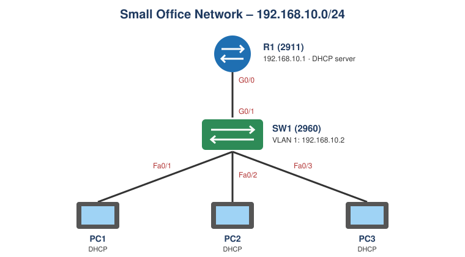

# Small Office Network Lab (Cisco Packet Tracer)

A beginner-friendly Cisco lab that sets up a secure network for a small office: one router, one switch and three PCs. Built and tested in Cisco Packet Tracer as CCNA practice.



## What this lab does

- **IP addressing** on a single office network: `192.168.10.0/24`
- **DHCP** on the router, so PCs get their IP address, gateway and DNS automatically
- **Device hardening**: hostnames, encrypted passwords, login banner, console timeouts
- **SSH** for secure remote management (Telnet disabled)
- **Unused switch ports shut down** to stop unauthorized devices from plugging in
- **Switch management IP** so the switch can be reached over the network

## Devices

| Device | Model (Packet Tracer) | Role |
|---|---|---|
| R1 | Cisco 2911 | Default gateway and DHCP server |
| SW1 | Cisco 2960 | Connects the office PCs |
| PC1–PC3 | PC-PT | Office workstations (DHCP clients) |

See [docs/addressing-table.md](docs/addressing-table.md) for the full addressing and cabling tables.

## Repository layout

```
configs/R1.txt                 Full router configuration
configs/SW1.txt                Full switch configuration
docs/addressing-table.md       IP addressing and cabling plan
docs/topology.svg              Network diagram
```

## How to rebuild it

1. In Packet Tracer, place a 2911 router, a 2960 switch and three PCs.
2. Cable them with copper straight-through cables as shown in the cabling table.
3. Open the CLI on R1 and paste in `configs/R1.txt`.
4. Open the CLI on SW1 and paste in `configs/SW1.txt`.
5. On each PC: **Desktop > IP Configuration > DHCP**.

## How to verify it works

| Test | Where | Command | Expected result |
|---|---|---|---|
| PCs got an address | PC1 | `ipconfig` | An address between 192.168.10.11 and .254 |
| Gateway reachable | PC1 | `ping 192.168.10.1` | Replies from R1 |
| PC to PC | PC1 | `ping` PC2's address | Replies |
| DHCP leases | R1 | `show ip dhcp binding` | All three PCs listed |
| Interfaces up | R1 | `show ip interface brief` | G0/0 up/up |
| SSH works | PC1 | `ssh -l admin 192.168.10.1` | Password prompt, then R1 prompt |
| Unused ports off | SW1 | `show interfaces status` | Fa0/4–24 show "disabled" |

## Notes

- Passwords in the configs are **lab-only examples**. Never reuse them on a real network.
- Next steps for this lab: add VLANs for separate departments, port security, and an access control list.
